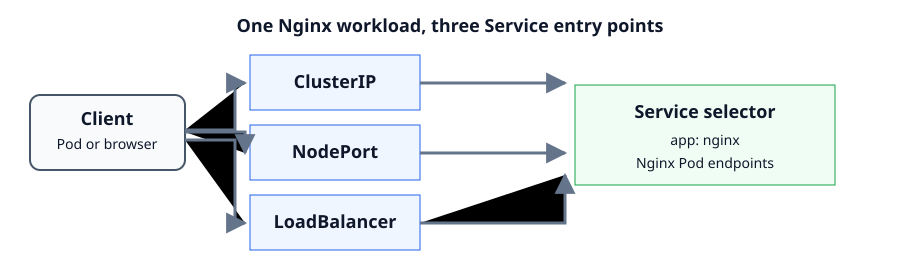

# Kubernetes Services: hands-on lab

This lab makes the same Nginx application reachable in three different ways:
inside the cluster with ClusterIP, through a node port, and through a cloud
load balancer. Read the manifests before running them so that labels,
selectors, ports, and namespaces are not magic values.

Run commands from the repository root unless a command says otherwise.



## Prerequisites

```bash
kubectl config current-context
kubectl get nodes -o wide
kubectl create namespace dev --dry-run=client -o yaml | kubectl apply -f -
kubectl create namespace qa --dry-run=client -o yaml | kubectl apply -f -
kubectl create namespace prod --dry-run=client -o yaml | kubectl apply -f -
```

## Exercise 1: ClusterIP and in-cluster DNS

Read the Pod and Service in `ClusterIP/`. The Service selector must match the
Pod label `app: nginx-server`.

```bash
kubectl apply -f "Kubernetes Services/ClusterIP/nginx-server.yaml"
kubectl apply -f "Kubernetes Services/ClusterIP/nginx-service.yaml"
kubectl wait --for=condition=Ready pod/nginx-server -n dev --timeout=120s
kubectl get pod nginx-server -n dev --show-labels -o wide
kubectl get service nginx-service -n dev -o wide
kubectl get endpointslice -n dev -l kubernetes.io/service-name=nginx-service
```

If the EndpointSlice has no addresses, compare the Pod labels with the Service
selector and inspect the Pod:

```bash
kubectl describe pod nginx-server -n dev
kubectl describe service nginx-service -n dev
```

Create the BusyBox client and send the request from inside the cluster:

```bash
kubectl apply -f "Kubernetes Services/ClusterIP/client-pod.yaml"
kubectl wait --for=condition=Ready pod/client-pod -n dev --timeout=120s
kubectl exec -n dev client-pod -- wget -qO- http://nginx-service
kubectl exec -n dev client-pod -- wget -qO- http://nginx-service.dev.svc.cluster.local
```

The Nginx HTML response proves that Kubernetes DNS resolved the Service and
that the Service forwarded traffic to its endpoint. The ClusterIP is stable;
the Pod IP is not.

## Exercise 2: create a NodePort from the terminal

Read `Nodeport/nginx-qa-deploy.yaml`, then create its two Nginx replicas:

```bash
kubectl apply -f "Kubernetes Services/Nodeport/nginx-qa-deploy.yaml"
kubectl rollout status deployment/nginx-qa -n qa
kubectl get deployment,pods -n qa -o wide
```

Now create the Service yourself. The command intentionally demonstrates how a
Service can be created without a Service manifest:

```bash
kubectl expose deployment nginx-qa \
  --name=nginx-qa \
  --type=NodePort \
  --port=80 \
  --target-port=80 \
  -n qa
```

Inspect the generated object instead of assuming its port:

```bash
kubectl get service nginx-qa -n qa -o wide
kubectl describe service nginx-qa -n qa
kubectl get endpointslice -n qa -l kubernetes.io/service-name=nginx-qa
kubectl get service nginx-qa -n qa -o jsonpath='{.spec.ports[0].nodePort}{"\n"}'
kubectl get nodes -o wide
```

With Minikube, ask Minikube for a reachable URL and request it from another
terminal:

```bash
minikube service nginx-qa -n qa --url
curl "$(minikube service nginx-qa -n qa --url)"
```

On another cluster, combine a reachable node address with the NodePort printed
above: `curl http://<node-ip>:<node-port>`. Firewalls and the cluster network
may prevent access from your workstation.

The directory also contains [nginx-deport.yaml](Nodeport/nginx-deport.yaml), a
declarative alternative that fixes the NodePort at `30080`. Use it instead of
the `kubectl expose` exercise when you want to compare imperative and
declarative Service creation:

```bash
kubectl apply -f "Kubernetes Services/Nodeport/nginx-deport.yaml"
kubectl get service nginx-nodeport -n qa
kubectl get endpointslice -n qa -l kubernetes.io/service-name=nginx-nodeport
```

The fixed port must be available on every node. Delete this alternative before
reusing the namespace:

```bash
kubectl delete -f "Kubernetes Services/Nodeport/nginx-deport.yaml" --ignore-not-found
```

## Exercise 3: use a LoadBalancer

Read both files in `LoadBalancer-Services/`. The Deployment labels Pods with
`app: nginx-production`, which is the selector used by the Service:

```bash
kubectl apply -f "Kubernetes Services/LoadBalancer-Services/nginx-prod.yaml"
kubectl apply -f "Kubernetes Services/LoadBalancer-Services/nginx-loadbalancer.yaml"
kubectl rollout status deployment/nginx-production -n prod
kubectl get deployment,pods -n prod -o wide
kubectl get service nginx-loadbalancer -n prod -w
```

Stop the watch with `Ctrl+C` after checking `EXTERNAL-IP` or `EXTERNAL-HOSTNAME`.
On a cloud cluster, use the assigned address:

```bash
kubectl get service nginx-loadbalancer -n prod -o wide
curl http://<external-address>
```

On Minikube, run `minikube tunnel` in a separate terminal before checking the
Service. Without a cloud integration or tunnel, `<pending>` is expected; the
Service can still be inspected internally.

## Troubleshooting practice

Use events and EndpointSlices to find the cause rather than repeatedly
reapplying manifests:

```bash
kubectl get events -n dev --sort-by=.lastTimestamp
kubectl get events -n qa --sort-by=.lastTimestamp
kubectl get events -n prod --sort-by=.lastTimestamp
kubectl describe service nginx-service -n dev
kubectl describe service nginx-qa -n qa
kubectl describe service nginx-loadbalancer -n prod
```

## Cleanup

```bash
kubectl delete -f "Kubernetes Services/ClusterIP/client-pod.yaml" --ignore-not-found
kubectl delete -f "Kubernetes Services/ClusterIP/nginx-service.yaml" --ignore-not-found
kubectl delete -f "Kubernetes Services/ClusterIP/nginx-server.yaml" --ignore-not-found
kubectl delete service nginx-qa -n qa --ignore-not-found
kubectl delete -f "Kubernetes Services/Nodeport/nginx-qa-deploy.yaml" --ignore-not-found
kubectl delete -f "Kubernetes Services/LoadBalancer-Services/nginx-loadbalancer.yaml" --ignore-not-found
kubectl delete -f "Kubernetes Services/LoadBalancer-Services/nginx-prod.yaml" --ignore-not-found
```

Delete `dev`, `qa`, and `prod` only when they are not shared with another lab.

## Manifest map

| Directory | Resources |
| --- | --- |
| `ClusterIP/` | Nginx Pod, ClusterIP Service, and BusyBox client Pod. |
| `Nodeport/` | Two-replica Nginx Deployment, plus imperative and declarative NodePort examples. |
| `LoadBalancer-Services/` | Three-replica Nginx Deployment and LoadBalancer Service. |
