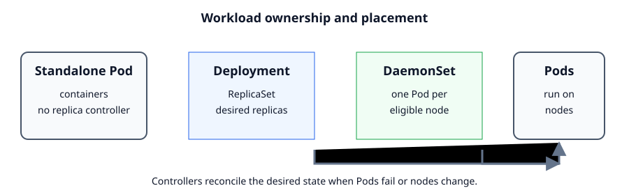

# Pods and workload controllers: hands-on lab

In this lab you will inspect a multi-container Pod, compare it with a
Deployment, scale replicas, and observe a DaemonSet as nodes join the cluster.
Run the commands from this directory.



## Prerequisites

You need a working Kubernetes context and `kubectl`. Install Minikube only if
you want to add a worker node in Exercise 4.

```bash
kubectl config current-context
kubectl get nodes -o wide
```

Create the namespaces once:

```bash
for namespace in dev qa prod; do
  kubectl create namespace "$namespace" --dry-run=client -o yaml | kubectl apply -f -
done
```

## Exercise 1: inspect and run a Pod

Open [apache-jenkins-pod.yaml](apache-jenkins-pod.yaml) before applying it.
Notice that it contains two containers, but also contains `replicas: 2` under
`spec`. A Pod cannot declare replicas; remove that line in your working copy
and save the file. A Deployment is the resource that owns replica counts.

Apply the corrected file and wait for both containers:

```bash
kubectl apply -f apache-jenkins-pod.yaml
kubectl wait --for=condition=Ready pod/apache-pod -n dev --timeout=180s
kubectl get pod apache-pod -n dev -o wide
kubectl describe pod apache-pod -n dev
```

Because this is one Pod with two containers, specify the container when reading
logs:

```bash
kubectl logs apache-pod -n dev -c apache-dev-container
kubectl logs apache-pod -n dev -c jenkins-dev-container
```

In a second terminal, forward Apache to your workstation and make a request:

```bash
kubectl port-forward pod/apache-pod -n dev 8080:80
curl http://127.0.0.1:8080
```

Stop port forwarding with `Ctrl+C`, then remove the standalone Pod:

```bash
kubectl delete pod apache-pod -n dev
```

## Exercise 2: let a Deployment maintain replicas

Read [apache-jenkins-deployment.yaml](apache-jenkins-deployment.yaml). Its
selector must match the labels in the Pod template. Apply it and inspect the
Deployment, ReplicaSet, and Pods it creates:

```bash
kubectl apply -f apache-jenkins-deployment.yaml
kubectl rollout status deployment/apache-pod-deployment -n dev
kubectl get deployment,replicaset,pods -n dev -o wide
```

Change the desired state from two to three replicas through the command line:

```bash
kubectl scale deployment/apache-pod-deployment -n dev --replicas=3
kubectl get deployment,pods -n dev
```

Delete one generated Pod and watch the Deployment replace it:

```bash
kubectl delete pod -n dev -l app=apache --wait=false
kubectl get pods -n dev -w
```

Stop the watch with `Ctrl+C`. Reapplying the manifest returns the desired
replica count to the value declared in the file:

```bash
kubectl apply -f apache-jenkins-deployment.yaml
kubectl rollout status deployment/apache-pod-deployment -n dev
```

## Exercise 3: observe a five-replica Deployment

Apply [apache-production-deployment.yaml](apache-production-deployment.yaml).
The `prod` name is part of the exercise; this is not a production-ready
configuration.

```bash
kubectl apply -f apache-production-deployment.yaml
kubectl rollout status deployment/apache-production -n prod
kubectl get deployment,replicaset,pods -n prod -o wide
```

Compare the Deployment selector and the labels on its Pods:

```bash
kubectl get pods -n prod --show-labels
kubectl describe deployment apache-production -n prod
```

## Exercise 4: observe a DaemonSet on every eligible node

Read [fluent-bit-daemonset.yaml](fluent-bit-daemonset.yaml), then apply it:

```bash
kubectl apply -f fluent-bit-daemonset.yaml
kubectl rollout status daemonset/fluent-bit-agent -n qa
kubectl get daemonset,pods -n qa -o wide
kubectl logs -n qa -l app=fluent-bit --tail=20
```

Compare the Pods' `NODE` values with `kubectl get nodes`. A DaemonSet creates
one Pod per eligible node, not a fixed replica count.

With Minikube, add a worker and observe the new DaemonSet Pod:

```bash
minikube node add
kubectl get nodes -w
kubectl get pods -n qa -o wide -w
```

Stop each watch with `Ctrl+C` after the new node and Pod become ready. If a
Pod stays pending or is not ready, inspect the scheduling events:

```bash
kubectl describe pod -n qa <pod-name>
kubectl get events -n qa --sort-by=.lastTimestamp
```

## Cleanup

```bash
kubectl delete -f fluent-bit-daemonset.yaml --ignore-not-found
kubectl delete -f apache-jenkins-deployment.yaml --ignore-not-found
kubectl delete -f apache-production-deployment.yaml --ignore-not-found
kubectl delete pod apache-pod -n dev --ignore-not-found
```

If these namespaces are not shared with another lab:

```bash
kubectl delete namespace dev qa prod
```

## What to remember

| Resource | Observation |
| --- | --- |
| Pod | Groups the Apache and Jenkins containers without replica management. |
| Deployment | Uses a ReplicaSet to maintain and replace a desired number of Pods. |
| DaemonSet | Places one Pod on each eligible node. |
