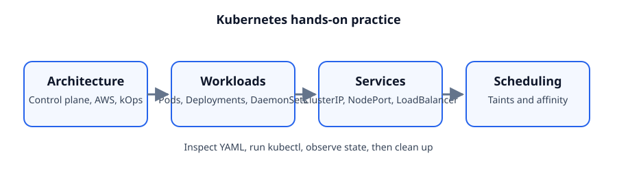
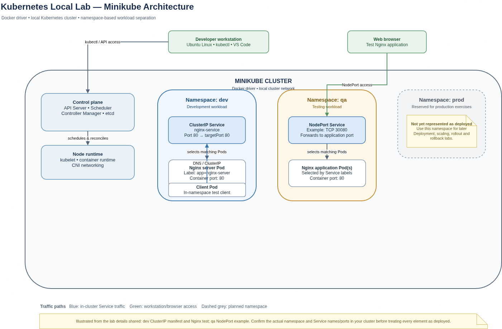
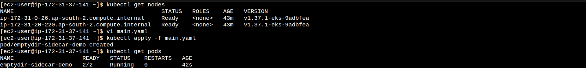
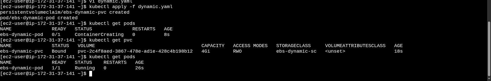
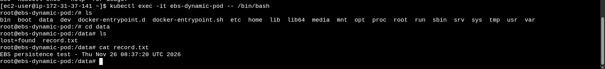

# Kubernetes hands-on practice

This repository is a small, command-driven Kubernetes lab. Each directory gives
you manifests to inspect and commands to run against a cluster that you are
allowed to modify.



<p align="center">
  
</p>

## Labs

1. [Cluster architecture and AWS/kOps preparation](CLuster-Architecure-Kops/README.md)
2. [Pods, Deployments, and DaemonSets](Pod%20architecture%20and%20lifecycle/README.md)
3. [Kubernetes Services](Kubernetes%20Services/README.md)
4. [Kubernetes Storage & Volumes on Amazon EKS](Kubernetes-Volumes/README.md)

The labs are independent after the cluster is available. The kOps lab is
specific to AWS; the other labs can use Minikube, kind, or another test
cluster.

## Before you start

Install `kubectl` and connect it to a disposable or learning cluster. Minikube
is useful for the multi-node DaemonSet exercise.

```bash
kubectl config current-context
kubectl cluster-info
kubectl get nodes -o wide
```

If these commands fail, fix the cluster context before applying any manifest.
Do not run the labs against a production cluster.

## A repeatable hands-on loop

For every exercise, first read the YAML and identify its namespace, labels,
selectors, ports, and replica count. Then use the following loop:

```bash
kubectl apply -f path/to/file.yaml
kubectl get all -n <namespace>
kubectl describe <resource> <name> -n <namespace>
kubectl get events -n <namespace> --sort-by=.lastTimestamp
```

Do not treat `kubectl apply` as proof that an application works. Wait for the
workload, inspect its status, and make a request from the correct network
location. The lab READMEs show the expected observations and failure checks.

## Quick start: workloads

Create the namespaces used by the workload and Service labs:

```bash
for namespace in dev qa prod; do
  kubectl create namespace "$namespace" --dry-run=client -o yaml | kubectl apply -f -
done
```

Start with the [Pod architecture and lifecycle lab](Pod%20architecture%20and%20lifecycle/README.md).
It deliberately begins with a standalone Pod, then compares it with a
Deployment and a DaemonSet.

## Quick start: Services

The [Services lab](Kubernetes%20Services/README.md) demonstrates ClusterIP,
NodePort, and LoadBalancer behavior. The LoadBalancer resource needs a cloud
provider or a local implementation such as `minikube tunnel`; otherwise its
external address can remain `<pending>`.

## Quick start: EKS storage

The [Kubernetes Storage & Volumes lab](Kubernetes-Volumes/README.md) documents
hands-on storage exercises on Amazon EKS `v1.37.1-eks-9adbfea` in `ap-south-2`.
It covers Pod-scoped `emptyDir`, dynamic `gp3` EBS provisioning with
`ReadWriteOnce`, and a statically provisioned EBS volume with a `Retain` policy
and node-affinity scheduling. Labs 2 and 3 require the EBS CSI add-on and its
required IAM permissions; the static-volume exercise also requires an EBS
volume and eligible node in the same Availability Zone.

<details>
<summary>View EKS storage lab screenshots</summary>

<p align="center">
  
</p>

<p align="center">
  
</p>

<p align="center">
  
</p>
</details>

## Cleanup

Delete only resources created for the exercise. The detailed guides include
resource-specific cleanup commands. If the namespaces were created only for
this repository, you can remove them after all exercises:

```bash
kubectl delete namespace dev qa prod
```

Namespace deletion is destructive for every resource in those namespaces, so
check their contents first:

```bash
kubectl get all -n dev
kubectl get all -n qa
kubectl get all -n prod
```
