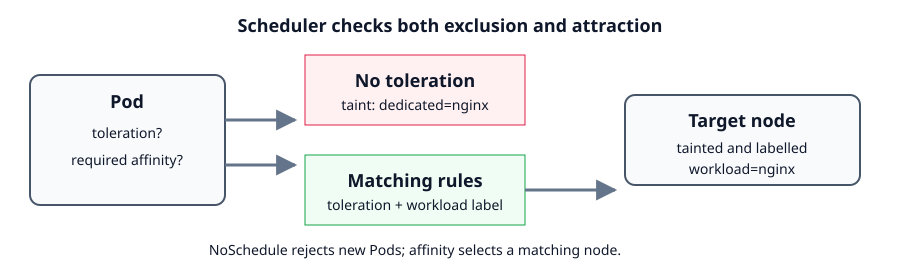

# Kubernetes taints and affinity: hands-on lab

This lab shows two different ways to influence Pod placement:

- **Taints and tolerations** keep Pods away from a node unless the Pod
  explicitly tolerates the node's taint.
- **Node affinity** attracts a Pod to nodes with labels that match its
  scheduling rule.

  

The supplied [nginx-pod.yaml](nginx-pod.yaml) is a baseline Pod. It has no
taint toleration or affinity rule, so Kubernetes may schedule it on any
available node.

Run the commands from this directory or use the path shown below. Use a
disposable learning cluster; the node labels and taints in this exercise
change scheduling for that node.

## Prerequisites

```bash
kubectl config current-context
kubectl get nodes -o wide
kubectl get nodes --show-labels
```

This exercise needs a node that can run workloads. Set its name in a shell
variable:

```bash
export NODE_NAME=<node-name>
kubectl label node "$NODE_NAME" workload=nginx --overwrite
```

Replace `<node-name>` with a value from `kubectl get nodes`. Do not include
the angle brackets.

## 1. Run the baseline Pod

Apply the provided manifest and inspect where Kubernetes placed it:

```bash
kubectl apply -f nginx-pod.yaml
kubectl wait --for=condition=Ready pod/nginx --timeout=120s
kubectl get pod nginx -o wide --show-labels
kubectl describe pod nginx
```

The `Node:` line in `describe` and the `NODE` column in `get` show the
selected node. `kubectl apply` only submits the object; `kubectl wait` checks
that the container actually became Ready.

## 2. Add a taint

Taint the selected node with the `NoSchedule` effect:

```bash
kubectl taint node "$NODE_NAME" dedicated=nginx:NoSchedule
kubectl describe node "$NODE_NAME" | grep -i taint
```

`NoSchedule` prevents new Pods that do not tolerate this taint from being
scheduled there. It does not evict an already-running Pod. Delete and recreate
the baseline Pod to observe the scheduling decision:

```bash
kubectl delete pod nginx
kubectl apply -f nginx-pod.yaml
kubectl get pod nginx -o wide
kubectl describe pod nginx
```

If the cluster has no other suitable node, `nginx` remains `Pending`. The
Events section reports an untolerated taint. On a multi-node cluster,
Kubernetes may place it on another node instead.

## 3. Add a toleration

The baseline manifest intentionally has no toleration. Create a second Pod
from the terminal with a matching toleration and required node affinity:

```bash
kubectl apply -f - <<EOF
apiVersion: v1
kind: Pod
metadata:
  name: nginx-tolerated
spec:
  tolerations:
  - key: dedicated
    operator: Equal
    value: nginx
    effect: NoSchedule
  affinity:
    nodeAffinity:
      requiredDuringSchedulingIgnoredDuringExecution:
        nodeSelectorTerms:
        - matchExpressions:
          - key: workload
            operator: In
            values:
            - nginx
  containers:
  - name: nginx
    image: nginx
EOF
kubectl wait --for=condition=Ready pod/nginx-tolerated --timeout=120s
kubectl get pod nginx-tolerated -o wide
```

The toleration permits the Pod to use the tainted node; it does not force the
Pod there. The `requiredDuringSchedulingIgnoredDuringExecution` affinity rule
forces it to use the node labelled `workload=nginx` (the node in
`$NODE_NAME`). `IgnoredDuringExecution` means the Pod is not evicted if the
label later changes.

## 4. Clean up

Remove the test Pods and restore the node before using the cluster for other
work:

```bash
kubectl delete pod nginx nginx-tolerated --ignore-not-found
kubectl taint node "$NODE_NAME" dedicated=nginx:NoSchedule-
kubectl label node "$NODE_NAME" workload-
```

The final label command is harmless if `workload` was never added. Confirm
that the taint and temporary label are gone:

```bash
kubectl describe node "$NODE_NAME" | grep -i taint || true
kubectl get node "$NODE_NAME" --show-labels
kubectl get pods -o wide
```

## Useful troubleshooting commands

```bash
kubectl get pod nginx -o yaml
kubectl describe pod nginx
kubectl get events --sort-by=.lastTimestamp
kubectl get nodes --show-labels
kubectl describe node "$NODE_NAME"
```

When a Pod is `Pending`, check the scheduler Events first. Common causes are
an unmatched taint, an affinity label that does not exist, or a required
affinity rule that matches no node.